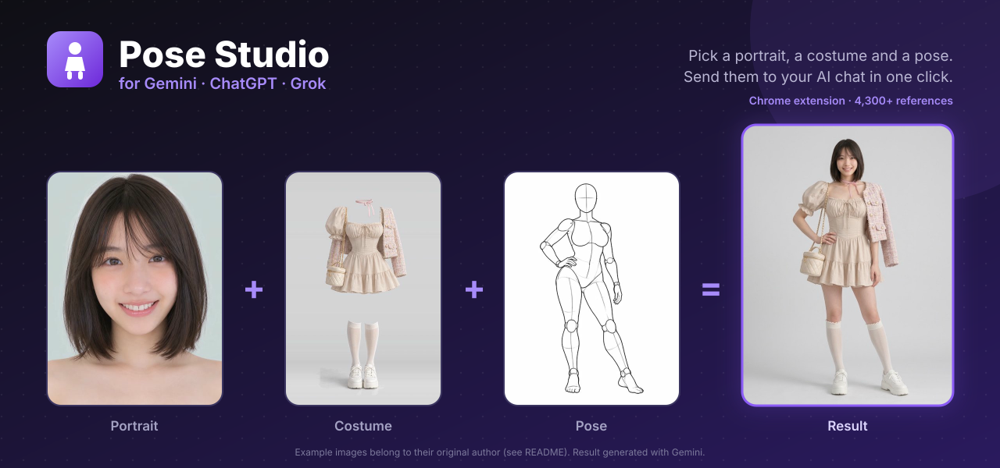

<p align="center">
  
</p>

<p align="center">
  <a href="#install-and-update"><b>⬇ How to install and update</b></a>
</p>

# Pose Studio for AI Chats (Chrome extension)

> **Disclaimer:** this is only a **test project made for educational purposes**. It is provided as is, with no warranty, and **we bear no responsibility** for how it is used or for anything that results from using it (including any account issues with the sites it works with). It is not affiliated with or endorsed by Google, OpenAI, or the original gallery authors.

> **Privacy: nothing is sent to us.** There is no server, account, analytics or tracking. Everything runs on your own computer, inside your browser. The images you pick and your prompt go only to the AI site you are using (**Gemini, ChatGPT or Grok**), through your own logged-in session in that tab, exactly as if you had attached them by hand. Your saved results and portraits stay in your browser's local storage and are never uploaded. The only other requests the extension makes are: downloading the reference pictures from the original public galleries (`*.pages.dev`), and asking GitHub for the latest release number to show the update notice. Neither sends any of your data.

## Two ways to use it

| | **Desktop: Chrome extension** | **Android phone: web app** |
|---|---|---|
| What it is | An extension for Chrome and other Chromium browsers | A website you can add to your Home screen |
| Works with | gemini.google.com, chatgpt.com, grok.com in the browser | The Gemini, ChatGPT and Grok **apps** (through Android's Share menu) |
| What it does for you | Attaches the images, pastes the prompt, picks the image tool, presses send, saves the result | Shares the images and prompt to the app you pick. You press send yourself |
| Get it | [Install the extension](#install-and-update) | **[Open the web app](https://aryan-mor.github.io/pose-studio-extension/)** |

Chrome on Android cannot run extensions, which is why the phone version is a web app.

Click the toolbar icon on **gemini.google.com**, **chatgpt.com** or **grok.com** and the page is covered by a picker with about 4,300 references: portraits, costumes and poses.

1. Pick a **portrait**, a **costume** and a **pose**. You can also **upload your own image** for any slot.
2. Choose a style preset. The prompt is generated, and you can edit it.
3. Press **Send**. The extension selects the **Create image** tool, attaches the images in order (Image 1/2/3 match the prompt), pastes the prompt and presses send. All of this happens behind a progress screen, so you never see the chat page.
4. When the image arrives, it is saved on your device and shown to you.

It runs on Gemini, ChatGPT and Grok. On any other site the icon shows "N/A". (Grok has no separate image tool, so there the prompt alone asks for the image.)

## Install and update

1. Download [**pose-studio-extension.zip**](https://github.com/Aryan-mor/pose-studio-extension/releases/latest/download/pose-studio-extension.zip) (always the latest release; the file name never changes). All releases are on the [releases page](../../releases).
2. **Unzip** it somewhere permanent. Chrome reads the extension from this folder, so don't delete it.
3. In Chrome, open `chrome://extensions`.
4. Turn on **Developer mode** (top right).
5. Click **Load unpacked** and select the unzipped folder, the one that contains `manifest.json`.
6. Click the puzzle-piece icon in the toolbar and **pin** Pose Studio.
7. Open [gemini.google.com](https://gemini.google.com), [chatgpt.com](https://chatgpt.com) or [grok.com](https://grok.com), sign in, and click the Pose Studio icon.

**Updating:** when a newer release exists, the Pose Studio overlay shows a **"A new version is available"** banner with a link back to this section. To update:

1. Download the zip again from the same link above.
2. Unzip it **over the old `pose-studio-extension` folder** and replace the files. The name is the same on purpose.
3. Open `chrome://extensions` and click the reload icon on the extension's card, then refresh your chat tab.

Your saved results and portraits are kept, because they live in the browser, not in that folder.

Works in Chrome and other Chromium browsers (Edge, Brave).

## Android phone web app

Open <https://aryan-mor.github.io/pose-studio-extension/> in Chrome on your phone, pick a portrait, a costume and a pose, then tap **Gemini**, **ChatGPT**, **Grok** or **Share…**. Android always shows its own share menu (a website can't pick the app for you), so choose the same app there; the button you tapped reminds you which. The full-size images are attached in order. Some apps, Gemini included, keep shared pictures but drop shared text, so the prompt is also drawn onto an extra "instructions" picture (switch off with *Also attach the prompt as an image*) and copied to the clipboard, so you can paste it too. **Your own photos:** tap the active slot a second time, or use **Upload** / **⬆ Upload photo**, to add photos from your gallery or camera. They are saved on your phone and listed first in that tab (under "My photos"), so you can reuse them later; ✕ deletes one. **Create portrait** works the same way with several photos of one person. In Chrome's menu choose **Add to Home screen** to install it like an app.

It updates itself: every push to `main` that changes the app is published to GitHub Pages by `.github/workflows/pages.yml`, and the phone picks up the new version on the next visit. Nothing is sent to us here either. The page runs on your phone and shares only to the app you choose.

## Features

- **Results are saved on your device.** After you send, the extension waits for the new image in the chat and stores it in the extension's own IndexedDB. Nothing is uploaded anywhere. Open **Saved** in the header to view, download or delete results. Untick "Save results on this device" to skip.
- **Create portrait** (button on the Portrait card, or **+ Create portrait** in the Portrait tab): add one or more photos of a person (up to 8, different angles work best) in the photo picker, then press **Create portrait**. They are sent with a prompt that asks for a 4×2 studio portrait sheet of the same person from 8 angles. The result is saved and shown **first in the Portrait list** under "My portraits". The prompt is `PORTRAIT_PROMPT` in `extension/src/prompt.ts`.
- **18+ items are flagged.** Some poses (Sexy, Intertwined) and costumes (Sexy, Lingerie) are adult-oriented and are marked **18+**. Gemini and ChatGPT do not allow adult content, so they will usually refuse these with an error. The Pose and Costume tabs show a warning notice. Nothing blocks or asks before sending. Standard items work reliably. This extension does not bypass any site's content rules.
- **Create image tool:** selected automatically before sending (can be turned off with the checkbox).
- Capture is best effort. It reads the assistant's reply on the page, so keep the chat tab open until the image appears (up to 8 minutes).

## Adding another site

Each site is a few selectors in `extension/src/site.ts` (message box, send button, result images, optional tool menu) plus its host in `extension/manifest.json`. See `AGENTS.md`.

If a site changes its page markup, the selectors at the top of `extension/src/site.ts` may need updating.

## Build from source

```bash
pnpm install
pnpm build            # typecheck + bundle → extension-dist/
```

Then load `extension-dist/` with **Load unpacked** as above. After code changes, run `pnpm build` again and click reload on the extension's card.

| Piece | File |
|---|---|
| Toolbar click, image storage, cross-origin image fetch | `extension/src/background.ts` |
| Overlay UI (Shadow DOM, so it can't clash with the host page) | `extension/src/content.ts`, `styles.ts` |
| Drives each site: attach images, fill text, pick the image tool, press send | `extension/src/site.ts` |
| Prompt builder, style presets, portrait prompt | `extension/src/prompt.ts` |
| Bundled data (`data/*-en.json`) and thumbnails (`thumbs/`) | copied by `scripts/build-extension.mjs` |

Thumbnails and metadata ship inside the extension. Full-resolution reference images are fetched when you send, from the original public galleries (`ai-pose-gallery.pages.dev`, `ai-costume-gallery.pages.dev`, `ai-portrait-gallery.pages.dev`), and the thumbnail is the fallback if that fails.

## Publishing a release (maintainers)

Pushing a version tag builds the extension in GitHub Actions and attaches the zip to a new release:

```bash
git tag v3.0.1
git push origin v3.0.1
```

The workflow is `.github/workflows/release.yml`. It sets the manifest version from the tag, builds with minification, and uploads `pose-studio-extension.zip` (no version in the name, so the download link is stable). It can also be run manually from the Actions tab, which produces a downloadable build artifact without making a release.

## Original project and credits

This is a modified copy of **[anhao/ai-pose-gallery-zh](https://github.com/anhao/ai-pose-gallery-zh)** (GitHub · [@anhao_ai](https://x.com/anhao_ai)), which mirrored and translated the three galleries and is the source of the data and thumbnails used here. This copy turns that web app into a browser extension. It is a separate copy and is not meant to be merged back into the original.

All pose, costume and portrait images and the original data belong to the original author **ギア (@giaaibusi)**. The original galleries are:

- Poses: <https://ai-pose-gallery.pages.dev/>
- Costumes: <https://ai-costume-gallery.pages.dev/>
- Portraits: <https://ai-portrait-gallery.pages.dev/>

The MIT license (see [LICENSE](LICENSE)) covers the code only, not the images in `thumbs/` or the data in `data/`. The galleries contain some adult-oriented pose and costume references. The portrait feature is intended for photos you have the right to use. Please respect the privacy and consent of the people in them.
